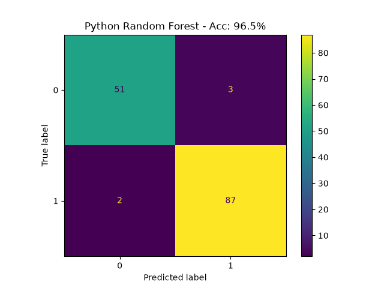
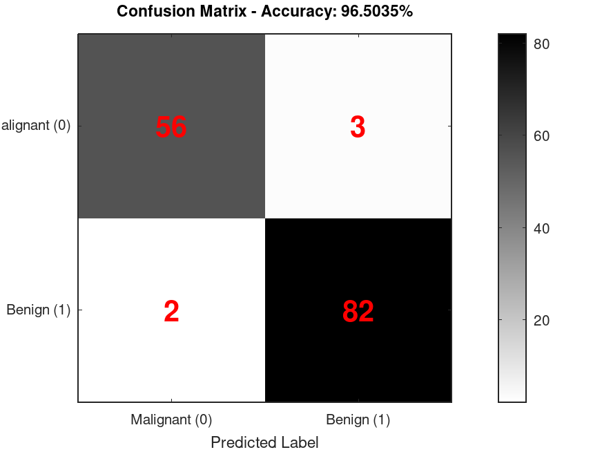

# 03 - Small Classifier

Goal: Compare Python vs Octave on the same medical dataset.

## Dataset
Breast Cancer Wisconsin (Diagnostic)
- 569 samples, 30 features
- Task: Classify tumour as Malignant (0) or Benign (1)
- Source: scikit-learn `load_breast_cancer()` / UCI
- Split: 75% train / 25% test (143 test samples)

## Methods

### Python (scikit-learn)
- Model: Random Forest (100 trees)
- Metrics: Accuracy + Confusion Matrix

### Octave
- Model: Logistic Regression
- Metrics: Accuracy + Confusion Matrix

## Results

| Version | Model | Accuracy | Correct / Total | Errors |
| --- | --- | --- | --- | --- |
| Python | Random Forest | 96.5% | 138 / 143 | 5 |
| Octave | Logistic Regression | 96.5% | 138 / 143 | 5 |

### Python Confusion Matrix

- Malignant correctly classified: 51, misclassified as Benign: 3
- Benign correctly classified: 87, misclassified as Malignant: 2

### Octave Confusion Matrix

- Malignant correctly classified: 56, misclassified as Benign: 3
- Benign correctly classified: 82, misclassified as Malignant: 2

## Comparison
Both models achieved identical accuracy (96.5%) and identical number of errors (5) on the test set. 
Note: The class distribution in the two test splits differs slightly (Python: 54 Malignant / 89 Benign, Octave: 59 Malignant / 84 Benign), so this is not a strictly paired comparison. Future work will use a fixed shared split / cross-validation for a fair comparison.

## How to Run

### Python
```bash
pip install -r requirements.txt
python classifier.py
